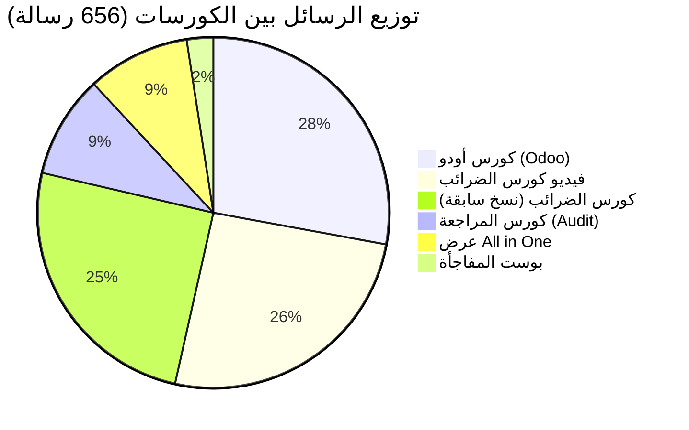

# 📊 تقرير الأداء الشامل لحملات Meta Ads (مجتمع المحاسبين)
**الفترة الزمنية:** 1 سبتمبر 2026 – 28 أكتوبر 2026  
**الصفحة الإعلانية:** Community of Accountants  
**الهدف الأساسي:** بدء محادثات ورسائل (Messaging Conversations Started)

---

## 1. 📌 الملخص التنفيذي (Executive Summary)

خلال الفترة الممتدة لـ 58 يوماً، تم تشغيل 8 حملات إعلانية رئيسية ركزت على تسويق البرامج والكورسات المحاسبية. حققت الحملات أداءً إجمالياً إيجابياً وتفاوتاً ملحوظاً بين طبيعة الكورسات والصيغ الإعلانية (فيديو مقابل بوستات ثابتة).

| المؤشر الرئيسي | القيمة المحققة | الملاحظات والدلالة |
| :--- | :---: | :--- |
| **إجمالي الإنفاق (Spend)** | **9,735.94 ج.م** | موزعة على كورسات الضرائب، أودو، المراجعة، وعرض All in One. |
| **إجمالي الرسائل (Results)** | **656 رسالة** | محادثات استفسار وشراء حقيقية عبر الماسنجر/الواتساب. |
| **متوسط تكلفة الرسالة (Avg CPR)** | **14.58 ج.م** | معدل تكلفة ممتاز ومنافس جداً في قطاع التدريب والتعليم المهني. |
| **إجمالي الوصول (Reach)** | **124,442 شخص** | عدد المحاسبين والمهتمين الفريدين الذين شاهدوا الإعلانات. |
| **إجمالي مرات الظهور (Impressions)** | **333,442 مرة** | معدل التكرار العام (Frequency) بلغ **2.68**. |
| **إجمالي النقرات على الروابط** | **2,022 نقرة** | نقرات مباشرة على زر الإعلان للتواصل. |
| **متوسط نسبة النقر (CTR All)** | **3.44%** | نسبة مرتفعة تدل على جاذبية المحتوى وجودة الاستهداف. |

---

## 2. 🏆 جدول مقارنة أداء الحملات والكورسات

تم ترتيب الحملات تصاعدياً بحسب **أقل تكلفة للرسالة (الأعلى كفاءة)**:

| اسم الكورس / الحملة | نوع الإعلان / المجموعة | المبلغ المنفق | عدد الرسائل | تكلفة الرسالة (CPR) | نسبة النقر (CTR) | الحالة |
| :--- | :--- | :---: | :---: | :---: | :---: | :---: |
| **1. كورس أودو (Odoo)** | `odoo course` | 1,411.25 ج.م | **183** | **7.71 ج.م** 🥇 | 3.18% | متوقفة |
| **2. عرض All in One** | `all in one` | 562.66 ج.م | **62** | **9.08 ج.م** 🥈 | 3.91% | متوقفة |
| **3. فيديو كورس الضرائب (الحالي)** | `tax video (New Sales)` | 2,055.96 ج.م | **153** | **13.44 ج.م** 🥉 | 3.07% | **شغالة (Active)** |
| **4. كورس الضرائب (نسخة سابقة)** | `كورس الضرايب (New Sales)` | 1,379.88 ج.م | **92** | **15.00 ج.م** | 3.66% | متوقفة |
| **5. كورس الضرائب القديم** | `tax course (عادي)` | 1,616.93 ج.م | **73** | **22.15 ج.م** | 4.07% | متوقفة |
| **6. كورس المراجعة (Audit)** | `New Sales ad` | 1,613.79 ج.م | **62** | **26.03 ج.م** | 3.76% | متوقفة |
| **7. بوست المفاجأة** | `المفاجأة المرة دي...` | 823.54 ج.م | **16** | **51.47 ج.م** ⚠️ | 1.95% | متوقفة |
| **8. تفاعل (Engagement)** | `New Engagement ad` | 169.88 ج.م | 21 تفاعل | 8.09 ج.م | 0.56% | متوقفة |
| **9. تجربة فيديو الضرائب الأولية**| `tax video (Deleted set)` | 102.05 ج.م | 15 | 6.80 ج.م | 5.29% | مؤرشفة |

---

## 3. 🔍 تحليل تفصيلي واستنتاجات محورية (Key Insights)

### 🌟 1. الحصان الرابح: كورس أودو (Odoo Course)
- حقق **أعلى عدد رسائل (183 رسالة)** و **أقل تكلفة (7.71 ج.م فقط)** من ميزانية 1,411 ج.م.
- هذا يوضح وجود طلب ضخم واحتياج شديد لبرامج الـ ERP وتحديداً Odoo بين المحاسبين.
- **التوصية:** يجب إعادة تشغيل هذه الحملة وزيادة ميزانيتها فوراً.

### 🎥 2. قوة الفيديو: مقارنة حاسمة في كورس الضرائب
- عند مقارنة الحملة الإعلانية العادية `tax course` القديمة (تكلفة الرسالة **22.15 ج.م**) بحملة الفيديو الحالية `video tax ccourse` (تكلفة الرسالة **13.44 ج.م**):
- **النتيجة:** صيغة الفيديو قللت تكلفة الحصول على العميل/الرسالة بنسبة **~40%**، وجلبت وحدها **168 رسالة** حتى الآن.

### 📦 3. عرض الباقة المتكاملة (All in One)
- حقق نتائج ممتازة جداً بتكلفة **9.08 ج.م للرسالة** (62 رسالة بصرف 562 ج.م فقط).
- صيغة الباقات المجمعة (Bundle) تعطي العميل شعوراً بقيمة عالية مقابل السعر.

### ⚠️ 4. نقاط الضعف والإهدار المالي:
1. **بوست المفاجأة (`المفاجأة المرة دي… إنتوا اللي هتختاروا!`):**
   - حقق تكلفة كارثية (**51.47 ج.م للرسالة**) ونسبة نقر ضعيفة جداً (**1.95%**)، وصرف 823 ج.م ولم ينتج عنه سوى 16 رسالة.
   - **السبب:** الرسائل الغامضة أو مسابقات "اختاروا بنفسكم" تجذب فضولاً غير موجه وتشتت العميل المحاسب الذي يبحث عن فائدة عملية واضحة.
2. **كورس المراجعة (`audit course`):**
   - تكلفة الرسالة **26.03 ج.م** وهي أعلى تكلفة بين الكورسات التخصصية، مما يشير إلى أن استهداف أو نص إعلان المراجعة يحتاج لإعادة صياغة (Hooks أفضل أو توضيح كيف تؤهل المراجعة للعمل في المكاتب الكبرى).

---

## 4. 🎯 خطة العمل والتوصيات للفترة القادمة (Action Plan)

### أولاً: إعادة توزيع الميزانية الذكية (Budget Allocation)
1. **استئناف كورس Odoo:** إعادة تشغيل الحملة بميزانية 250 - 300 ج.م يومياً فوراً.
2. **توسيع عرض All in One:** إعادة إطلاقه بحملة منفصلة كعرض ترويجي، مع رفع الميزانية تدريجياً.
3. **الاستمرار في فيديو الضرائب الحالي:** الحملة الحالية `video tax ccourse` تعمل بكفاءة (13.44 ج.م) ويجب تركها تعمل مع مراقبة مؤشر التكرار (Frequency) كي لا يتجاوز 2.5 في Ad Set الحالي.

### ثانياً: استراتيجية المحتوى الإعلاني (Creatives & Hooks)
- **اعتماد الفيديو كصيغة أساسية:** بعد نجاح فيديو الضرائب، يجب تصوير فيديوهات قصيرة (Reels / 60-90 ثانية) لكورس **أودو** وكورس **المراجعة** (المحاضر يتحدث عن مشكلة محاسبية في الواقع العملي والحل داخل الكورس).
- **إلغاء الإعلانات الغامضة:** التوقف تماماً عن إعلانات البوستات المبهمة والتركيز على العناوين المباشرة (مثل: محاور الكورس، المشاريع العملية، الشهادة، فرصة التأهيل لسوق العمل).

### ثالثاً: تحسين الإغلاق والمبيعات (Closing & Sales CRM)
- مع تحقيق **656 رسالة استفسار**، يجب مراجعة:
  - كم نسبة من قاموا بالشراء الفعلي من الـ 656 عميل؟ (معدل التحويل Conversion Rate).
  - إذا كان معدل الإغلاق أقل من 5%، فالمشكلة تكون في سرعة الرد أو طريقة عرض السعر على الواتساب/الماسنجر.
  - إرسال رسائل متابعة (Follow-up / Retargeting) لكل من تواصل سابقاً بخصوص عرض الـ All in One أو كورس الأودو.
